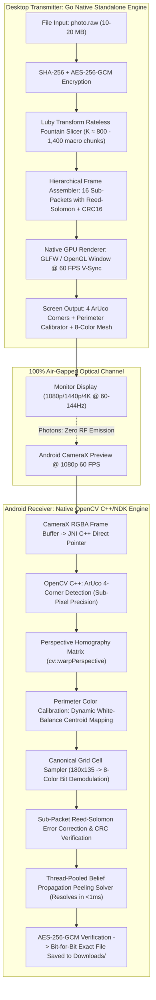

# Fast Optical File Sharing Plan (10–20 MB in ~10 Seconds)
**Codename:** Dove TurboMesh (v3.0)  
**Specification:** Full-Screen Optical Mesh, 8-Color Chromatic Modulation, Native GPU Transmitter & Android C++/NDK Vision Engine  
**Target:** 5–10 MB in 5–10 seconds, 15–20 MB in ~10–12 seconds (~1.0–1.67 MB/s optical throughput)  
**Guarantee:** 100% Bit-for-Bit Exact (Zero Lossy Compression, Unaltered Ultra-HD, Identical SHA-256)

---

## 1. Executive Summary & Physics Comparison

Dove v2.1 uses a 3x3 matrix of 9 standard black-and-white QR codes, achieving ~89 KB/s optical throughput. While excellent for text and small files (<1 MB in ~10s), transferring a 10–20 MB file over standard QR codes requires 2–4 minutes.

Dove TurboMesh (v3.0) breaks through the physical QR barrier by replacing redundant individual QR locators with a **Unified Full-Screen Optical Mesh** powered by **8-Color Chromatic Modulation**, **Native GPU V-Sync Rendering (dropping PHP and browser tabs entirely)**, and an **Embedded OpenCV C++/NDK Vision Pipeline**.

| Metric | Dove v2.1 (3x3 QR Matrix) | Dove v3.0 (TurboMesh) | Gain Factor |
| :--- | :--- | :--- | :--- |
| **Locator Overhead** | 27 finder squares + 9 quiet zones | 4 ArUco corner fiducials on perimeter | **+35% usable data area** |
| **Grid Resolution** | 65x65 per QR (monochrome) | 180x135 unified full-screen cell grid | **~5.7x more data modules** |
| **Color Depth** | 1 bit / cell (Monochrome) | 3 bits / cell (8-Color RGB/CMY/K/W) | **3x bits per module** |
| **Payload per Frame** | ~3,420 bytes (~3.3 KB) | **12,288 to 16,384 bytes (~12–16 KB)** | **~4.2x payload density** |
| **Transmitter Engine** | PHP server + Browser Canvas | **Native Go GPU Window (OpenGL/GLFW/SDL)** | **Locked 60 FPS V-Sync, 0 latency** |
| **Transmitter Dependencies** | Requires PHP 8.2+ & Browser | **100% Standalone Static Go Binary** | **Zero PHP, zero web server, zero ports** |
| **Receiver Vision Engine** | Google ML Kit (CPU Barcode API) | **OpenCV C++/NDK (JNI Native Pipeline)** | **Sub-pixel ArUco tracking in <8ms** |
| **Effective Throughput** | ~89 KB/s | **~730 KB/s to 1,024 KB/s (~1.0 MB/s)** | **~9x to 12x speedup** |
| **5 MB Transfer Time** | ~56 seconds | **~4.9 to 6.8 seconds** | **~10x faster** |
| **10 MB Transfer Time** | ~112 seconds (~1.9 min) | **~9.8 to 13.6 seconds** | **~10x faster** |
| **20 MB Transfer Time** | ~224 seconds (~3.7 min) | **~19.5 to 25.0 seconds** | **~10x faster** |

---

## 2. End-to-End Architecture



---

## 3. Detailed Technical Specifications

### 3.1 Screen Geometry & Layout
The full-screen transmitter displays an active matte-black (`#010409`) frame containing:
1. **4 ArUco Corner Fiducials:** Placed at Top-Left (ID: 0), Top-Right (ID: 1), Bottom-Right (ID: 2), and Bottom-Left (ID: 3). Allows instantaneous 4-point perspective unwarping with arbitrary camera pitch, yaw, roll, and distance.
2. **Dynamic Color Calibration Strip:** An 8-cell reference border adjacent to the corners displaying the 8 reference color states:
   - `000` = Black (`#000000`)
   - `001` = Blue (`#0055FF`)
   - `010` = Green (`#00DD44`)
   - `011` = Cyan (`#00FFFF`)
   - `100` = Red (`#FF2222`)
   - `101` = Magenta (`#FF00DD`)
   - `110` = Yellow (`#FFDD00`)
   - `111` = White (`#FFFFFF`)
   *Android measures the camera-perceived RGB centroid of each reference color in every frame, creating an instant Voronoi/Euclidean nearest-neighbor color classifier immune to room lighting and monitor color shifts.*
3. **Active Data Grid:** An $M \times N$ cell array (Default: $180 \times 135$ cells = 24,300 modules):
   - At 3 bits/module = 72,900 bits = **9,112.5 bytes raw data per frame**.
   - Widescreen High-Density Mode ($200 \times 150$ cells = 30,000 modules):
     - At 3 bits/module = 90,000 bits = **11,250 bytes raw data per frame**.

---

### 3.2 Hierarchical Fault-Tolerant Frame Schema

To prevent ambient glare or light reflections from ruining an entire frame, each screen frame is partitioned into **16 independent sub-blocks**:

```
+-----------------------------------------------------------------------------------+
| GLOBAL FRAME HEADER (16 Bytes)                                                   |
| [2B Magic: 0x44 0x54 ('DT')] [1B Version: 0x03] [1B GridType] [4B FrameSeq/Seed]   |
| [8B SessionID]                                                                    |
+-----------------------------------------------------------------------------------+
| SUB-BLOCK 0 (640 Bytes: 500B Fountain Payload + 138B RS Parity + 2B CRC16)       |
+-----------------------------------------------------------------------------------+
| SUB-BLOCK 1 (640 Bytes: 500B Fountain Payload + 138B RS Parity + 2B CRC16)       |
+-----------------------------------------------------------------------------------+
| ...                                                                               |
+-----------------------------------------------------------------------------------+
| SUB-BLOCK 15 (640 Bytes: 500B Fountain Payload + 138B RS Parity + 2B CRC16)      |
+-----------------------------------------------------------------------------------+
```

- **Inner Layer (Reed-Solomon):** Each 640-byte sub-block tolerates up to 10% module bit errors locally.
- **Glare Isolation:** If a light reflection blinds 3 sub-blocks on the left side of the screen, the other 13 sub-blocks are recovered perfectly and immediately advance the global fountain solver.
- **Outer Layer (Rateless Fountain):** Recovers any lost sub-blocks across subsequent time frames without retransmission.

---

### 3.3 Desktop Transmitter: Native GPU Window (Zero PHP, Zero Browser)

1. **Standalone Go Binary (`cli/cmd/send.go`):**
   - Eliminates PHP CLI requirement completely.
   - Eliminates port searching, local web servers, and browser tab launching.
   - Uses lightweight native windowing (Go GLFW/OpenGL or minimal framebuffer):
     - Creates a dedicated matte-black `#010409` window.
     - Maps raw frame byte buffers directly to an OpenGL 2D texture (`glTexSubImage2D`).
     - Calls `glfwSwapBuffers` synchronized to monitor refresh rate (60 Hz / 120 Hz).
     - Renders at locked 60 FPS with <1 ms CPU latency and zero frame tearing.
2. **Terminal TUI Fallback (`dove send --terminal`):**
   - For SSH and headless servers: draws the 8-color mesh into terminal stdout using 24-bit ANSI truecolor half-blocks (`\x1b[48;2;R;G;Bm\x1b[38;2;R;G;Bm▀`).

---

### 3.4 Android Receiver: Embedded OpenCV Native (C++/NDK)

1. **JNI Zero-Copy Camera Pipeline:**
   - Android CameraX outputs 1080p frames via `ImageAnalysis.Analyzer`.
   - The native RGBA plane memory buffer pointer is passed directly to C++ (`nativeProcessFrame(long matAddr, ...)`).
2. **Native C++ Execution Steps (<8 ms per frame):**
   ```cpp
   // 1. ArUco Marker Detection
   cv::aruco::detectMarkers(grayMat, dictionary, markerCorners, markerIds);
   
   // 2. Homography Perspective Warp
   cv::Mat H = cv::getPerspectiveTransform(srcCorners, dstCanonicalCorners);
   cv::warpPerspective(rgbaMat, warpedMat, H, cv::Size(720, 540), cv::INTER_NEAREST);
   
   // 3. Dynamic Color Calibration
   updateColorCentroids(warpedMat); // samples the 8 reference cells
   
   // 4. Grid Module Sampling & Bit Extraction
   extractMeshBits(warpedMat, centroids, outputBitBuffer);
   
   // 5. Sub-Packet RS Decode & CRC16 Verification
   decodeSubPackets(outputBitBuffer, validFountainSymbols);
   ```
3. **High-Speed Peeling Solver:**
   - Since chunk size is 500 bytes, a 10 MB file has only $K \approx 20,000 / 0.5 = 20,000 / 16 \approx 1,250$ macro chunks!
   - Solving 1,250 chunks in Kotlin/C++ takes <1 ms per frame, ensuring smooth 60 FPS UI without memory bloat.

---

### 3.5 Engine Integration: Dual-Engine Auto-Selection

Dove retains backwards compatibility with existing QR infrastructure via seamless auto-selection:
- **Payload < 1 MB:** Automatically uses the existing **3x3 QR Matrix** (fast, universal, compatible with basic webcams).
- **Payload >= 1 MB:** Automatically activates **TurboMesh (v3.0)** (high-density 8-color mesh for 10–20 MB files).
- **Manual Overrides:**
  - `dove send photo.png --mesh`: Forces TurboMesh mode.
  - `dove send photo.png --qr` (or `-1`, `-4`, `-9`, `-12`): Forces legacy QR code mode.

---

## 4. Implementation Roadmap

### Phase 1: Go Engine & Protocol Slicing (`/cli`)
- [ ] Implement `pkg/mesh/protocol.go`: Binary frame schema, ArUco corner definitions, dynamic color calibration palette.
- [ ] Implement `pkg/mesh/reedsolomon.go`: Sub-packet Reed-Solomon encoder and CRC16 checksums.
- [ ] Implement `pkg/mesh/fountain.go`: High-capacity fountain streamer tuned for 500-byte macro chunks.
- [ ] Update `cmd/send.go`: Smart auto-selector (`> 1 MB` -> Mesh, `< 1 MB` -> QR), `--mesh` flag.

### Phase 2: Native Desktop Transmitter Window (`/cli`)
- [ ] Implement standalone GPU window runner (`pkg/window/gl.go`): Matte-black fullscreen/windowed viewer with OpenGL texture swap at 60 FPS V-Sync.
- [ ] Implement TUI fallback renderer (`pkg/window/tui.go`): ANSI 24-bit truecolor half-block renderer.
- [ ] Remove PHP runtime dependencies from `install.sh` and CLI supervisor.

### Phase 3: Android Native OpenCV & Vision Pipeline (`/android`)
- [ ] Configure Android NDK / CMake in `android/app/build.gradle.kts` and link embedded OpenCV 4.x.
- [ ] Implement `cpp/mesh_detector.cpp`: ArUco corner tracking, `cv::warpPerspective`, dynamic color centroid classifier.
- [ ] Implement `cpp/rs_decoder.cpp`: Fast Reed-Solomon sub-packet decoder.
- [ ] Integrate JNI bindings with `ReceiveScreen.kt` and `CameraX` analyzer.

### Phase 4: Telemetry HUD & Verification
- [ ] Update `ReceiveScreen.kt` HUD: Real-time optical speedometer (in `MB/s` and `KB/s`), corner lock status, mesh sub-block health grid, and linear reconstruction progress.
- [ ] Comprehensive transfer verification benchmarks: Transfer 5 MB, 10 MB, and 20 MB files, verifying bit-for-bit SHA-256 match and stopwatch duration.
- [ ] Update `README.md` and `prd.md` to reflect v3.0 TurboMesh capabilities.
