# Product Requirements Document (PRD): Dove

**Project Name:** Dove  
**Type:** Air-Gapped Optical File Sharing System (CLI, PHP Session Engine, Android App)  
**Status:** Approved Specification  
**Architecture:** Monorepo (`/cli`, `/web`, `/android`, `/docs`)

---

## 1. Executive Summary & Vision

Dove is an air-gapped, zero-network file transfer utility designed to securely transfer files bidirectionally between desktop computers (Linux, macOS, Windows) and mobile devices (Android) with **100% optical transmission**.

Dove operates under zero-trust, zero-radio assumptions:
- **No Wi-Fi required.**
- **No Internet connection or cloud servers required.**
- **No Bluetooth or local hotspot pairing required.**
- **Zero RF emission or radio sniffing vulnerability.**

Data is sliced, compressed, encrypted, and streamed optically as high-frequency animated QR codes on screen, captured and reconstructed by optical camera sensors (webcam on desktop, CameraX on mobile). Using **rateless fountain erasure codes (Luby Transform / UR-style)**, a single desktop screen can broadcast a file simultaneously to **100+ Android phones** without requiring any synchronization or two-way radio handshakes.

---

## 2. Core User Workflows

```mermaid
flowchart TD
    subgraph PC_To_Phone["PC -> Phone (Broadcast to 1-100 Phones)"]
        A["CLI: dove send file.txt --100m"] --> B["Go: zstd Compress + AES-256-GCM Encrypt"]
        B --> C["Go: Rateless Fountain Encoder (LT)"]
        C --> D["PHP: session.php spins up local web server"]
        D --> E["Browser Tab: High-FPS Animated QR Stream Player"]
        E --> F["1 to 100 Android Phones scan screen via CameraX"]
        F --> G["Android: Fountain Decoder reconstructs + decrypts file"]
    end

    subgraph Phone_To_PC["Phone -> PC (Camera Scan)"]
        H["CLI: dove get"] --> I["Go + PHP: Launch browser tab with Webcam Scanner"]
        J["Android App: Tab 'Send' picks file"] --> K["Android: Encrypts + displays Animated QR on phone screen"]
        K --> L["PC Webcam scans phone screen"]
        L --> M["PHP/Go: Reconstructs payload, decrypts, and saves to disk"]
    end
```



### 2.1 PC to Phone (`dove send`)
1. User navigates to a directory in their terminal and runs:
   ```bash
   dove send presentation.pdf --100m
   ```
2. The Go CLI reads the file, compresses it via `zstd`, encrypts it using `AES-256-GCM`, generates an ephemeral session key (included in the stream header) or optional `--pin`, and feeds chunks into a rateless Fountain Encoder.
3. The Go CLI spawns PHP's built-in web server (`php -S 127.0.0.1:<port>`) serving `web/session.php`.
4. The system opens the default desktop browser tab displaying a clean, high-FPS animated QR code canvas player.
5. Up to 100 people point their Dove Android app camera at the screen. The rateless fountain decoder captures frames asynchronously and reconstructs the file locally on each phone.
6. When the time expires (e.g. 100 minutes) or when the user halts the process (`Ctrl+C`), `session.php` wipes temporary memory/buffers, terminates the local server, and closes cleanly.

### 2.2 Phone to PC (`dove get`)
1. User runs `dove get` in their terminal.
2. The Go CLI launches the local PHP service and opens a browser tab with a centered webcam viewport.
3. On the Dove Android app, user navigates to the **Send** tab, selects a file, and clicks **Stream**.
4. The phone screen loops the high-FPS encrypted animated QR stream.
5. The desktop user holds the phone screen up to the computer webcam.
6. The web scanner reads the fountain frames, passes them to the backend, reconstructs the original file, verifies the integrity checksum, decrypts the payload, and saves the file directly into the current terminal working directory.

---

## 3. Technology Stack & Responsibilities

| Component | Technology | Primary Responsibilities |
| :--- | :--- | :--- |
| **CLI Engine** | Go (Golang 1.22+) | Single self-contained binary. File I/O, `zstd` compression, `AES-256-GCM` encryption, rateless Luby Transform fountain code generation/reconstruction, process supervisor for PHP. |
| **Session & Web Service** | PHP 8.2+ (`web/session.php`) | Clean, standard, non-bloated procedural/OOP PHP. Spun up via `php -S 127.0.0.1:<port>`. Manages session countdown/TTL, automatic session destruction, file import/staging metadata, and serves the high-performance HTML5/Canvas animated QR stream and webcam scanner. |
| **Mobile App** | Android (Kotlin + Jetpack Compose) | Native Android APK. CameraX for high-framerate optical decoding, Jetpack Compose UI modeled after the official GitHub Android app (matte black dark mode `#010409`, clean light mode `#FFFFFF`, standard SVG vector icons, zero emojis). |

---

## 4. Optical Transmission & Fountain Protocol Specification

### 4.1 Data Pipeline
```
[Raw File] 
   ──> [zstd Compression] 
   ──> [AES-256-GCM Encryption] 
   ──> [Split into K Slices (300-500 bytes each)] 
   ──> [Luby Transform (LT) Rateless Fountain Symbols] 
   ──> [Frame Packaging] 
   ──> [Animated QR Stream @ 12-20 FPS]
```

### 4.2 Frame Binary Schema
Each optical QR frame encapsulates an immutable binary header and fountain payload:

```
+---------------+----------------+----------------+----------------+---------------------+----------------+
| Magic (2B)    | Version (1B)   | Session ID (8B)| Seq / Seed (4B)| Degree (2B)         | Payload (N B)  |
| 0x44 0x56     | 0x01           | Ephemeral UUID | PRNG Seed      | Chunk indices XOR'd | Encrypted Data |
+---------------+----------------+----------------+----------------+---------------------+----------------+
| Checksum (4B) |
| CRC32-IEEE    |
+---------------+
```

- **Magic Bytes:** `0x44 0x56` (`"DV"` in ASCII).
- **Session ID:** 64-bit ephemeral identifier tying frames to a single session.
- **Rateless Seed & Degree:** Uses a Robust Soliton Distribution to pick chunk combinations. A receiver requires only $K \times (1 + \epsilon)$ frames (typically $\approx 1.05 \times K$) to reconstruct the file completely, regardless of which individual frames were missed.
- **Optical Tuning:** Payload per frame is constrained to 300–450 bytes (QR Version 10–14, Error Correction Level `L` or `M`) to guarantee sharp contrast, fast scanning across camera distances, and resistance to screen motion blur.

---

## 5. Desktop CLI Specification (`dove`)

### 5.1 Commands & Flags

#### `dove send <filepath> [flags]`
- `<filepath>`: Path to the target file.
- `--<N>m`: Session duration in minutes (e.g. `--100m`, `--15m`, `--5m`). If omitted, session defaults to unlimited (runs until `Ctrl+C`).
- `--pin <4-6 digits>`: Optional custom encryption PIN. If omitted, an ephemeral 256-bit key is embedded seamlessly into the optical stream header.
- `--terminal`: Stream animated QR directly to terminal stdout using ANSI half-block characters (`\u2580`, `\u2584`), bypassing browser launch.
- `--fps <rate>`: Frame rate for animation (default: `14`, range: `5-30`).

#### `dove get [flags]`
- `--output <dir>`: Destination folder for received files (default: current directory `.`).
- `--terminal`: Use terminal camera capture if supported (default launches clean browser webcam interface).

---

## 6. PHP Session Engine Specification (`session.php`)

### 6.1 Architectural Rules
- Standard, lightweight PHP (clean procedural or modular OOP; no heavy frameworks like Symfony or Laravel).
- Executed via PHP's built-in CLI web server: `php -S 127.0.0.1:<port> -t ./web`.
- Handles session lifecycle states:
  - `INIT`: Generates ephemeral session tokens and registers countdown timer.
  - `STREAM`: Delivers chunk arrays or fountain seeds to the browser canvas renderer.
  - `IMPORT`: Receives captured frames from webcam interface for `dove get` and validates file assembly.
  - `DESTROY`: Triggers automatic cleanup when countdown expires, deleting temporary staged buffers and issuing graceful server shutdown.

---

## 7. Android Application Specification

### 7.1 UX / UI Design Principles
- **Aesthetic Benchmark:** Modeled after the official **GitHub Android Application**.
- **Dark Theme:** Matte Black (`#010409` canvas, `#0D1117` surface cards, `#30363D` borders, `#C9D1D9` primary text).
- **Light Theme:** High-contrast neutral (`#FFFFFF` background, `#F6F8FA` surfaces, `#D0D7DE` borders).
- **Iconography:** Strictly standard SVG vector drawables (Material / Octicons vector paths).
- **NO EMOJIS:** Absolute prohibition of emojis in UI strings, button labels, toasts, logs, and code comments.
- **Typography:** System default monospace / sans-serif with strict typographic hierarchy.

### 7.2 Tab Architecture (3-Tab Navigation)
1. **Send Tab:**
   - Native document picker button.
   - File details card (name, size, mime type, estimated frames).
   - High-contrast animated QR player with FPS throttle and display brightness boost button.
2. **Receive Tab:**
   - Full-screen CameraX optical scanner viewport with minimalist corner reticle.
   - Real-time fountain progress bar: `"Reconstructing: 142/150 symbols (95%)"`.
   - Auto-decryption and prompt to save into Android `Downloads/` directory upon completion.
3. **Settings / History Tab:**
   - Theme toggle (Matte Black / Light / System).
   - Log of previous transfers (file name, size, timestamp, SHA256 integrity hash).
   - Optical tuning (target scanning FPS, camera resolution).

---

## 8. Monorepo Structure

```
dove/
├── cli/                 # Go CLI Engine
│   ├── cmd/
│   │   ├── send.go      # 'dove send' command logic
│   │   ├── get.go       # 'dove get' command logic
│   │   └── root.go      # Cobra/CLI initialization
│   ├── pkg/
│   │   ├── crypto/      # AES-256-GCM encryption & key derivation
│   │   ├── fountain/    # Luby Transform (LT) encoder & decoder
│   │   ├── compress/    # zstd compression routines
│   │   └── qr/          # QR matrix generator & ANSI terminal printer
│   └── main.go
├── web/                 # PHP Session & Desktop Browser Engine
│   ├── session.php      # Session lifecycle, countdown, self-destruction
│   ├── index.php        # Routing entry point
│   ├── player.html      # High-FPS canvas QR streamer
│   ├── scanner.html     # Webcam optical reader interface
│   └── assets/          # Pure CSS (GitHub matte black) and SVGs
├── android/             # Android Studio Project
│   ├── app/
│   │   ├── src/main/
│   │   │   ├── java/com/dove/app/
│   │   │   │   ├── ui/          # Jetpack Compose screens (Send, Receive, Settings)
│   │   │   │   ├── camera/      # CameraX analyzer pipeline
│   │   │   │   ├── fountain/    # Kotlin fountain decoder implementation
│   │   │   │   └── crypto/      # Android Keystore & AES decryption
│   │   │   └── res/drawable/    # Pure SVG vector assets (No PNG slop, No Emojis)
│   └── build.gradle.kts
├── docs/                # Architecture diagrams and specifications
├── agent.md             # Strict AI Agent Implementation Rules
├── prd.md               # Product Requirements Document
├── README.md
└── LICENSE
```

---

## 9. Security & Privacy Guarantees
1. **Zero Attack Surface over RF:** Since no Wi-Fi, cellular, or Bluetooth interfaces are active, network sniffing, MITM, ARP poisoning, and rogue AP exploits are physically impossible.
2. **Physical Line-of-Sight Protection:** Only devices with a clear visual line of sight to the transmitting display can receive data.
3. **End-to-End Cryptography:** Payloads are encrypted with AES-256-GCM before symbol generation. Even if third-party cameras record the screen, payloads remain encrypted without session credentials.
4. **Zero Telemetry:** No analytics, crash reporters, or external network requests are baked into either the CLI, PHP, or Android codebases.
