# Product Requirements Document (PRD): Dove

**Project Name:** Dove  
**Type:** Air-Gapped Optical File Sharing System (CLI, PHP Session Engine, Android App)  
**Status:** Approved Specification (v2.1: Turbo Multi-Matrix & Flexible Optical Vision)  
**Architecture:** Monorepo (`/cli`, `/web`, `/android`, `/docs`)

---

## 1. Executive Summary & Vision

Dove is an air-gapped, zero-network file transfer utility designed to securely transfer files bidirectionally between desktop computers (Linux, macOS, Windows) and mobile devices (Android) with **100% optical transmission**.

Dove operates under zero-trust, zero-radio assumptions:
- **No Wi-Fi required.**
- **No Internet connection or cloud servers required.**
- **No Bluetooth or local hotspot pairing required.**
- **Zero RF emission or radio sniffing vulnerability.**

Data is sliced, compressed, encrypted, and streamed optically as high-frequency animated QR codes on screen, captured and reconstructed by optical camera sensors (webcam on desktop, CameraX on mobile).

### 1.1 Ultra-Fast Turbo Matrix & Flexible Optical Vision (v2.1)
To achieve optical file transfer of 1 MB files (photos, documents, archives) in **approximately 10 seconds** (~100 KB/s throughput):
- **Spatial Matrix Transmitter:** Desktop emits a synchronized matrix of QR codes (default: `3x3` = 9 concurrent emitters; widescreen: `4x3` = 12 emitters).
- **Unified Fountain Pool:** All matrix emitters emit distinct Luby Transform (LT) symbols from the same unified fountain encoder. Every symbol captured advances the global linear decoding matrix without head-of-line blocking or quadrant-specific lock-in.
- **Flexible Scanning Modes (Multi-QR or 1-by-1):**
  - **Wide View Mode:** Users can point the camera at the entire screen (~50 cm distance) to capture all 9 to 12 QR codes simultaneously for maximum ~100 KB/s throughput.
  - **1-by-1 Sequential Scanning Mode:** Users can hold the camera close to scan individual QR codes or pan across the display one by one. Each symbol captured from any visible QR code continues advancing the same global reconstruction counter.
- **Real-Time Telemetry & Counting HUD:** Complete on-screen telemetry showing:
  - Exact symbol count captured.
  - Chunks resolved vs total required chunks: `Resolved: X / K (Percentage%)`.
  - Codes In View counter: dynamically displays the number of QR codes actively detected in the current camera frame (e.g. `Codes in view: 9` or `1`).
  - Real-time optical speedometer in `KB/s` and `symbols/sec`.
  - Dynamic green bounding reticles (`#238636`) overlaid on every detected QR code.
- **Persistent Optical Tuning Engine:** Complete settings persistence (`SettingsManager` backed by `SharedPreferences`) allowing instant tuning of transmission FPS (8-30 FPS), camera analysis resolution (1080p vs 720p), and visual theme.

---

## 2. Core User Workflows

```mermaid
flowchart TD
    subgraph PC_To_Phone["PC -> Phone (Turbo Matrix Optical Stream)"]
        A["CLI: dove send photo.jpg --grid 3x3 --fps 26"] --> B["Go: zstd Compress + AES-256-GCM Encrypt"]
        B --> C["Go: Rateless Fountain Encoder (380B Dynamic Chunks, K ≈ 2,632)"]
        C --> D["PHP: session.php spins up local web server"]
        D --> E["Browser Tab: 3x3 Synchronous Matrix Canvas @ 26 FPS"]
        E --> F{"Android Scanning Mode"}
        F -->|Wide Distance| G["Scan all 9 QRs simultaneously (~10s transfer)"]
        F -->|Close-up / Pan| H["Scan 1-by-1 or subsets (seamless incremental progress)"]
        G --> I["Android: ML Kit Offline Multi-Barcode Detector"]
        H --> I
        I --> J["Android: Telemetry HUD displays codes in view, speed, progress"]
        J --> K["Android: Unified Fountain Decoder resolves symbols + auto-decrypts"]
    end

    subgraph Phone_To_PC["Phone -> PC (Adaptive Single / Dual Stream)"]
        L["CLI: dove get"] --> M["Go + PHP: Browser tab with Multi-Barcode Webcam Scanner"]
        N["Android App: Tab 'Send' picks file (1x1 or 1x2 mode)"] --> O["Android: Encrypts + streams animated QR(s) at configured FPS"]
        O --> P["PC Webcam scans phone screen"]
        P --> Q["Browser: Native BarcodeDetector / Split jsQR decodes stream"]
        Q --> R["PHP/Go: Reconstructs payload, decrypts, and saves to disk"]
    end
```



### 2.1 PC to Phone (`dove send`)
1. User runs `dove send photo.jpg --grid 3x3 --fps 26` in terminal.
2. The Go CLI reads the file, compresses via `zstd`, encrypts using `AES-256-GCM`, dynamically tunes chunk sizes (380 bytes for 1 MB payloads), and generates an infinite rateless fountain stream.
3. The Go CLI spawns PHP built-in web server (`php -S 127.0.0.1:<port>`) serving `web/session.php`.
4. The system opens the desktop browser displaying a 3x3 matrix of synchronized QR codes with quiet zones.
5. Android user points Dove app camera at the monitor:
   - Standing ~50 cm back captures all 9 QR codes per frame (~100 KB/s throughput, ~10s for 1 MB).
   - Moving closer or panning scans individual QR codes one by one without errors or stalling.
6. Real-time telemetry HUD displays active bounding reticles around detected QRs, symbols received, chunks resolved, codes in view, and current KB/s.
7. Symbols feed into a single unified `FountainDecoder`. Once sufficient symbols are captured ($K \times 1.05$), the file automatically decrypts and saves into Android `Downloads/`.
8. Once finished or canceled (`Ctrl+C`), temporary session buffers are wiped.

### 2.2 Phone to PC (`dove get`)
1. User runs `dove get` in terminal.
2. The Go CLI launches the local PHP service and opens a browser tab with a webcam scanner.
3. In the Dove Android app, user selects file in **Send** tab and chooses layout:
   - **1x1 Standard:** Single large centered QR code (optimal for lower-resolution 720p webcams).
   - **1x2 Stacked:** Two vertically stacked QR codes (doubles speed for modern 1080p webcams).
4. Desktop browser decodes incoming frames using the native `BarcodeDetector` API (with split-region `jsQR` fallback), reassembles the fountain symbols, and downloads the file to the current terminal directory.

---

## 3. Technology Stack & Responsibilities

| Component | Technology | Primary Responsibilities |
| :--- | :--- | :--- |
| **CLI Engine** | Go (Golang 1.22+) | Static standalone binary. File I/O, `zstd` compression, `AES-256-GCM`, dynamic chunk scaling (128-480 bytes), infinite rateless Luby Transform fountain code generation, multi-stream matrix coordinator, and PHP supervisor. |
| **Session & Web Service** | PHP 8.2+ (`web/session.php`) | Procedural/modular lightweight PHP. Spun up via `php -S 127.0.0.1:<port>`. Manages session countdown/TTL, automatic buffer deletion, serves the 3x3/4x3 canvas multi-QR player, and hosts the multi-barcode webcam scanner. |
| **Mobile App** | Android (Kotlin + Jetpack Compose) | Native Android APK. CameraX + Bundled Offline Google ML Kit Barcode Scanning (`com.google.mlkit:barcode-scanning`) for 30+ FPS multi-QR capture. Live telemetry HUD with bounding boxes and speedometer. 100% air-gapped. Zero emojis. |
| **Settings & Optical Tuning** | Android SharedPreferences | Persistent store for transmission FPS (8-30 FPS), CameraX preview resolution (1080p vs 720p), and visual appearance theme. |
| **Webcam Vision (Desktop)** | Web BarcodeDetector API + Fallback | Hardware-accelerated multi-barcode decoding in Chromium browsers; dual-region `jsQR` fallback for non-Chromium environments. |

---

## 4. Optical Transmission & Fountain Protocol Specification

### 4.1 Data Pipeline
```
[Raw File] 
   ──> [zstd Compression] 
   ──> [AES-256-GCM Encryption] 
   ──> [Dynamic Chunk Partitioning (380B for 1 MB payloads)] 
   ──> [Luby Transform (LT) Rateless Fountain Symbols] 
   ──> [Matrix Cell Dispatch: Cell 0 .. Cell N-1] 
   ──> [Synchronous 3x3 / 4x3 Canvas Matrix @ 26 FPS]
```

### 4.2 Dynamic Chunk Sizing Table
To balance optical scan reliability with frame count reduction:
- Payload < 50 KB: 128 bytes/chunk
- Payload 50 KB - 200 KB: 256 bytes/chunk
- Payload 200 KB - 800 KB: 320 bytes/chunk (QR v11)
- Payload >= 800 KB: 380 bytes/chunk (QR v12, Level L)

### 4.3 Frame Binary Schema
Each optical QR frame encapsulates an immutable binary header and fountain payload:

```
+---------------+----------------+----------------+----------------+---------------------+----------------+
| Magic (2B)    | Version (1B)   | Session ID (8B)| Seq / Seed (4B)| Degree (2B)         | Payload (N B)  |
| 0x44 0x56     | 0x02           | Ephemeral UUID | PRNG Seed      | Chunk indices XOR'd | Encrypted Data |
+---------------+----------------+----------------+----------------+---------------------+----------------+
| Checksum (4B) |
| CRC32-IEEE    |
+---------------+
```

- **Unified Fountain Peeling:** All cells feed into the exact same Gaussian elimination / belief propagation solver. Each captured symbol carries its own PRNG seed and degree, making every capture mathematically additive regardless of whether codes are scanned all at once or one by one.

---

## 5. Desktop CLI Specification (`dove`)

### 5.1 Commands & Flags

#### `dove send <filepath> [flags]`
- `<filepath>`: Path to target file.
- `--<N>m`: Session duration in minutes (default: unlimited).
- `--pin <4-6 digits>`: Optional custom encryption PIN.
- `--grid <1x1|2x2|3x3|4x3>`: Display grid layout (default: `3x3` for browser; `1x1` for terminal).
- `--fps <rate>`: Refresh frame rate (default: `26`, range: `8-30`).
- `--chunk-size <bytes>`: Optional override for fountain symbol payload size (range: `128-600`).
- `--terminal`: Stream animated QR directly to terminal stdout using ANSI half-block characters (`\u2580`, `\u2584`). Falls back to 1x1 unless terminal width > 160 columns.

#### `dove get [flags]`
- `--output <dir>`: Destination folder for received files (default: `.`).
- `--terminal`: Terminal camera capture if supported.

---

## 6. Web Companion Engine (`/web`)

### 6.1 Multi-QR Player (`player.html`)
- Displays a synchronized 3x3, 4x3, or 2x2 canvas matrix styled in GitHub dark mode (`#010409`).
- Uses QR Error Correction Level `L` (7%) for maximum payload density.
- Atomic double-buffered redraw on `requestAnimationFrame` ensures all matrix cells flip simultaneously without partial frame tear.
- Real-time session timer countdown, payload statistics, and active FPS monitor.

### 6.2 Webcam Scanner (`scanner.html`)
- Uses `window.BarcodeDetector` to decode multiple barcodes per video frame concurrently.
- If `BarcodeDetector` is unsupported (e.g. Firefox), the canvas analyzer partitions the frame into dual vertical regions and executes split-instance `jsQR` decoding.
- Progress bar displays real-time fountain symbol reception and degree elimination status.

---

## 7. Android Application Specification

### 7.1 Visual & UX Principles
- Modeled after the official **GitHub Android Application**.
- Dark Mode: `#010409` canvas, `#0D1117` cards, `#30363D` borders, `#C9D1D9` text.
- Standard SVG vector icons.
- **Zero Emojis:** Strictly prohibited in all UI elements, strings, logs, and comments.

### 7.2 Tab Architecture
1. **Send Tab:**
   - Document picker and file inspection card.
   - Grid layout selector: `1x1 (Standard)` or `1x2 (Dual Stream)`.
   - High-FPS canvas QR streamer utilizing user-configured transmission FPS from `SettingsManager`.
2. **Receive Tab (Flexible Optical Scanner):**
   - Full-screen CameraX optical scanner viewport.
   - Offline ML Kit multi-barcode detection analyzer handling 1 to 12 QRs per frame.
   - Supports both simultaneous full-screen scanning and 1-by-1 zoomed scanning seamlessly.
   - Dynamic green bounding reticles (`#238636`) drawn over all actively detected QR codes.
   - Telemetry HUD:
     - `Resolved: X / K symbols (Y%)` with high-contrast linear progress bar.
     - `Codes in view: N` (live counter of QR codes visible in current exposure).
     - `Symbols captured: TotalCount`.
     - `Speed: SpeedKBps KB/s (SymPerSec sym/s)`.
   - Auto-decryption and direct save to Android `Downloads/`.
3. **Settings Tab (Persistent Optical Tuning):**
   - Backed by `SettingsManager` (`SharedPreferences`).
   - Theme toggle: True Matte Black (`#010409`) vs Light.
   - Transmission Framerate slider: 8 to 30 FPS (immediately configures `SendScreen`).
   - Camera Resolution selector: 1080p FHD (recommended for multi-QR) vs 720p HD.
   - Transfer history with SHA-256 verification hashes.

---

## 8. Performance Benchmarks & Targets

| Metric | Dove v1.0 (Single QR) | Dove v2.0 (2x2 Grid) | Dove v2.1 Turbo (3x3 Matrix) |
| :--- | :--- | :--- | :--- |
| **Grid Cells** | 1 | 4 | **9** |
| **Bytes / Symbol** | 320 B | 380 B | **380 B** |
| **Frame Rate** | 14 FPS | 18 FPS | **26 FPS** |
| **Instantaneous Throughput** | ~3.8 KB/s | ~27 KB/s | **~89–102 KB/s** |
| **100 KB File Time** | ~30s | ~4.5s | **~1.2s** |
| **500 KB File Time** | ~2.5m | ~20s | **~5.2s** |
| **1 MB File Time** | ~6.5m | ~38s | **~9.8 - 11.0s** |
| **Scanning Flexibility** | Single code only | Grid only | **Both all-at-once AND 1-by-1 sequential** |

---

## 9. Security & Air-Gap Guarantees
1. **Zero RF Emission:** No Wi-Fi, Bluetooth, NFC, or cellular radios utilized.
2. **Offline ML Kit Guarantee:** Uses exclusively bundled offline model assets within the APK; zero external API calls or Google Play Services network dependencies.
3. **End-to-End Cryptography:** AES-256-GCM authenticated encryption for all payloads.
4. **Ephemerality:** All temporary session buffers in CLI, PHP, and Android are wiped upon transfer completion or timer expiration.
